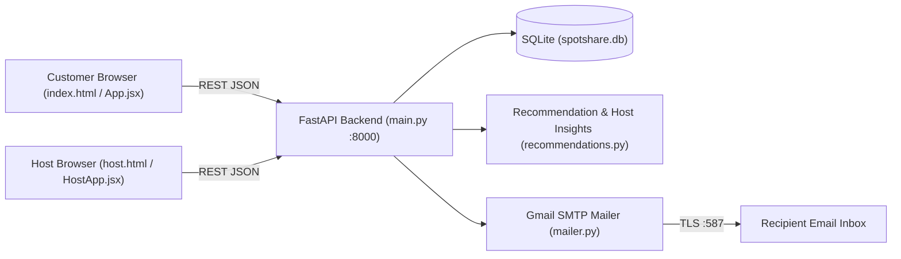

# SpotShare

**Hyperlocal Parking & EV Charging Marketplace** — find, compare, and book nearby parking spaces or EV charging stations in real time, or list and manage your own private/commercial charging bays from a dedicated Host Hub.


---

## Table of Contents

- [Overview](#overview)
- [Features](#features)
  - [Customer Marketplace](#customer-marketplace)
  - [Host Hub](#host-hub)
  - [Authentication & Password Recovery](#authentication--password-recovery)
- [Architecture](#architecture)
- [Tech Stack](#tech-stack)
- [Project Structure](#project-structure)
- [Getting Started](#getting-started)
  - [Prerequisites](#prerequisites)
  - [Installation](#installation)
  - [Environment Configuration](#environment-configuration)
  - [Running the App](#running-the-app)
- [Application URLs](#application-urls)
- [Core Business Rules & Engine Logic](#core-business-rules--engine-logic)
- [API Reference](#api-reference)
- [Database Management](#database-management)
- [Testing & Production Build](#testing--production-build)
- [Troubleshooting](#troubleshooting)

---

## Overview

SpotShare connects **EV drivers and commuters** with **parking lots and private/commercial EV charger hosts**. Built around Mysuru demo coordinates (`12.2958, 76.6394`) with 16 pre-seeded locations, the platform supports:

- **Live slot availability** calculated per `[start, end)` time window against active reservations.
- **Interactive map and list views** with zero paid map API keys (OpenStreetMap + Leaflet).
- **Host operational controls** to publish chargers, track earnings, or temporarily **Turn Off / Close** a station when out of town without losing listing data or booking history.
- **Real Gmail SMTP verification codes** for password resets.

---

## Features

### Customer Marketplace
- **Dedicated Parking & EV Modes:** Switch seamlessly between **Parking** (blue theme) and **EV Charging** (emerald theme) with category-specific filters.
- **Multi-Criteria Filtering & Sorting:**
  - Search by station name, area, or landmark.
  - Filter by **Distance** (Haversine km from Mysuru default or live browser GPS), **Price**, **Vehicle Type** (`car`, `bike`, `van`, `covered`), **Charger Type** (`AC` / `DC`), **Connector** (`Type 2`, `CCS2`, `CHAdeMO`), **Charging Power** (kW), **Owner Type** (`Public` / `Private Owners`), and **Available Now**.
  - Sort by **Nearest**, **Cheapest**, or **Top Rated**.
- **Interactive Map View:**
  - Dark-styled **OpenStreetMap** tiles via **Leaflet**.
  - Pulsing GPS user marker and color-coded price/status pins (`#6366f1` Regular, `#10b981` EV Ready, `#ef4444` Occupied, `#64748b` Closed).
  - Floating spot drawer for one-click **Book Now** and **Google Maps Directions**.
- **Booking Lifecycle & History:**
  - Dynamic cost estimate before submission, authoritative server-side pricing and conflict checking, and instant digital voucher receipt.
  - **My Bookings** view with **Active Bookings** and **Booking History** tabs, soft cancellation, and **Remove All** cleanup.
- **Favorites & Profile:** Save favorite spots and view account details in the sidebar navigation.

### Host Hub
- **Host Dashboard (`host.html` or `Host / Owner` tab):**
  - Top metric cards for **Active Chargers** (plus closed count), **Active Bookings**, **Booked Value** (`₹`), and **Available Bays**.
- **Publish New Chargers:** Add a station with name, address, GPS coordinates (**Auto-detect My Location** or manual), hourly rate (`₹/hr`), charger power (`kW`), bay capacity, supported vehicle types, and quick-pick amenities.
- **Turn Off / Close & Turn On / Reopen Stations:**
  - Temporarily pause bookings when away or out of town via **Turn Off / Close** (`PATCH /api/spots/{spot_id}/status`) instead of permanently deleting the station.
  - Closed stations keep all metadata and booking records intact, display a **Closed / Offline** status across Host and Customer views, reject new bookings (`409 spot_closed`), and are excluded from recommendations until reopened.
- **Permanent Removal:** **Remove Charger** deletes a station and its bookings after confirmation.

### Authentication & Password Recovery
- **Unified Auth Experience:** Customer login/registration card (`Customer Login` and `Host / Owner` tabs) with inline **Register an account** / **Sign in here** toggles, **Confirm Password** validation, and **Continue with Google** account picker.
- **Focus-Safe Password Toggle:** Custom [`PasswordInput`](frontend/src/components/PasswordInput.jsx) component hides browser-native reveal icons (such as Edge `::-ms-reveal`) and preserves typing cursor focus without stealing Spacebar or Tab navigation.
- **Gmail SMTP Password Reset:** **Forgot password?** sends a 6-digit verification code to the user's registered email via TLS SMTP, backed by server-side SHA-256 OTP hashing, 10-minute expiration, single-use validation, and a 5-attempt lockout.

---

## Architecture



---

## Tech Stack

| Layer | Technologies |
|---|---|
| **Backend** | Python 3.10+, FastAPI (`>=0.110,<1.0`), Uvicorn (`>=0.29,<1.0`), Pydantic v2 (`>=2.6,<3.0`), SQLite (`sqlite3`), `smtplib` |
| **Frontend** | React 18, Vite 5, Leaflet (`^1.9.4`), CSS3 |
| **Testing** | `pytest` + FastAPI `TestClient` |

---

## Project Structure

```text
CDD/
├── backend/
│   ├── main.py                # FastAPI routes, CORS middleware, unified JSON error handlers
│   ├── database.py            # SQLite schema, migrations, demo seeding, concurrency & OTP logic
│   ├── models.py              # Pydantic v2 request/response schemas & validators
│   ├── mailer.py              # Dynamic .env reader & Gmail TLS/SSL SMTP sender
│   ├── recommendations.py     # Multi-factor spot ranking & host analytics
│   ├── test_backend.py        # pytest unit & integration test suite (9 tests)
│   ├── requirements.txt       # Python dependencies
│   ├── .env.example           # SMTP configuration template
│   └── spotshare.db           # SQLite database (auto-created on first run)
├── frontend/
│   ├── index.html             # Customer marketplace HTML entry
│   ├── host.html              # Standalone Host Hub HTML entry
│   ├── vite.config.js         # Multi-page Vite build configuration
│   ├── package.json           # Frontend scripts & npm dependencies
│   ├── .env.example           # Frontend environment template
│   ├── public/images/spots/   # Local parking & EV spot photographs
│   └── src/
│       ├── main.jsx           # Customer React root
│       ├── host-main.jsx      # Host React root
│       ├── App.jsx            # Customer auth, explore, map, bookings, favorites, profile
│       ├── HostApp.jsx        # Host auth, metrics, charger management, live bookings
│       ├── AddChargerForm.jsx # New EV charger creation form with GPS & validation
│       ├── api.js             # Host fetch client & field-level ApiError parser
│       ├── styles.css         # Customer & shared UI styles
│       ├── HostApp.css        # Host dashboard styles
│       └── components/
│           ├── BookingModal.jsx   # Time-window booking form & digital receipt
│           ├── FilterBar.jsx      # Category-aware search, filters & sorting controls
│           ├── ParkingMap.jsx     # Leaflet + OpenStreetMap view with interactive drawer
│           ├── PasswordInput.jsx  # Custom show/hide password input
│           ├── SpotCard.jsx       # Spot summary card with availability & directions
│           ├── SpotShareLogo.jsx  # Brand logo SVG component
│           └── SmartInsights.jsx  # Insights panel component stub
├── package.json               # Workspace-level helper scripts
├── run.bat                    # Windows one-command launcher
├── run.sh                     # macOS / Linux one-command launcher
└── README.md
```

---

## Getting Started

### Prerequisites
- **Python 3.10+** (tested with Python 3.12)
- **Node.js 18+** and **npm**

### Installation

1. **Install backend dependencies:**
   ```bash
   cd backend
   pip install -r requirements.txt
   ```

2. **Install frontend dependencies:**
   ```bash
   cd frontend
   npm install
   ```

### Environment Configuration

#### 1. Backend Email / SMTP (`backend/.env`) — *Required for Forgot Password emails*
SpotShare uses one sender mailbox to deliver 6-digit password-reset codes to **any** customer or host email address.

1. Enable **2-Step Verification** on the sender Google account and create a 16-character **App Password** at `https://myaccount.google.com/apppasswords`.
2. Copy `backend/.env.example` to `backend/.env` and set your credentials:
   ```env
   SPOTSHARE_SMTP_HOST=smtp.gmail.com
   SPOTSHARE_SMTP_PORT=587
   SPOTSHARE_SMTP_USER=yourgmail@gmail.com
   SPOTSHARE_SMTP_PASSWORD=your_16_char_app_password
   SPOTSHARE_SMTP_FROM=SpotShare <yourgmail@gmail.com>
   ```
   > `mailer.py` reads `backend/.env` dynamically on each request and strips spaces from App Passwords automatically—no backend restart is required after saving.

#### 2. Optional Backend Variables
| Variable | Default | Description |
|---|---|---|
| `SPOTSHARE_DB_PATH` | `backend/spotshare.db` | Custom SQLite database file path |
| `SPOTSHARE_CORS_ORIGINS` | `*` | Comma-separated list of allowed CORS origins |
| `SPOTSHARE_CHECKIN_EARLY_MINUTES` | `15` | Minutes before `start_time` when simulator check-in opens |
| `SPOTSHARE_ALLOW_PAST` | `0` | Set to `1` during tests to allow past booking timestamps |

#### 3. Frontend (`frontend/.env`) — *Optional*
Defaults to `http://localhost:8000`. Copy `frontend/.env.example` to `frontend/.env` to customize:
```env
VITE_API_BASE_URL=http://localhost:8000
```

### Running the App

#### Option A: One-Command Launch
- **Windows:**
  ```bat
  run.bat
  ```
- **macOS / Linux:**
  ```bash
  chmod +x run.sh
  ./run.sh
  # or: npm start
  ```

#### Option B: Manual Two-Terminal Launch
- **Terminal 1 (Backend):**
  ```bash
  cd backend
  python -m uvicorn main:app --port 8000 --reload
  ```
- **Terminal 2 (Frontend):**
  ```bash
  cd frontend
  npm run dev
  ```

---

## Application URLs

| Surface | URL |
|---|---|
| **Customer Marketplace** | `http://localhost:5173` |
| **Host Hub (Standalone)** | `http://localhost:5173/host.html` *(also via **Host / Owner** tab on login)* |
| **Backend API** | `http://localhost:8000` |
| **Interactive API Docs (Swagger UI)** | `http://localhost:8000/docs` |

---

## Core Business Rules & Engine Logic

- **Timezone & Intervals:** All API timestamps use naive IST (`Asia/Kolkata`, `UTC+05:30`) in ISO 8601 format (`YYYY-MM-DDTHH:MM:SS`). Reservations use half-open intervals `[start, end)` so back-to-back bookings at the same boundary (e.g., ending at `12:00` and starting at `12:00`) never conflict.
- **Booking Constraints:**
  - Duration must be between **30 minutes** and **24 hours**.
  - Start time may be at most **5 minutes** in the past (`PAST_GRACE_MINUTES`).
  - Spot must be **open** (`is_active == True`), support the requested `vehicle_type`, offer EV charging if `requires_ev_charging=true`, and have `peak_concurrency(intervals, start, end) < capacity` inside a `BEGIN IMMEDIATE` SQLite transaction.
- **Recommendation Scoring (`recommendations.py`):** Open candidate spots with free capacity are scored from `0` to `100`:
  - **35%** Proximity (normalized Haversine distance)
  - **30%** Price competitiveness
  - **20%** Rating
  - **15%** EV charging capability
- **OTP Password Reset Security:** Codes are 6-digit random numbers (`secrets.randbelow`), stored as salted SHA-256 hashes, valid for **10 minutes**, single-use, and locked after **5 failed verification attempts**.

---

## API Reference

All errors return a uniform JSON shape:
```json
{
  "detail": "Human-readable error message",
  "code": "machine_error_code",
  "errors": [{ "field": "body.field", "message": "..." }]
}
```

### Auth & Password Reset
| Method | Endpoint | Description |
|---|---|---|
| `POST` | `/api/auth/forgot-password` | Generate a 6-digit OTP and send via Gmail SMTP (`role`: `customer` \| `host`) |
| `POST` | `/api/auth/verify-reset-code` | Verify 6-digit OTP against SQLite (`expires_in_minutes`: 10, max 5 attempts) |

### Spots & Host Station Controls
| Method | Endpoint | Description |
|---|---|---|
| `GET` | `/api/spots` | List/filter spots (`q`, `lat`, `lng`, `max_distance_km`, `min_price`, `max_price`, `ev_charging`, `vehicle_type`, `available_only`, `start_time`, `end_time`, `sort`, `owner_name`) |
| `GET` | `/api/spots/{spot_id}` | Fetch single spot details and window availability |
| `POST` | `/api/spots` | Publish a new parking or EV charging spot (`201`) |
| `PATCH` | `/api/spots/{spot_id}/status` | Temporarily close (`is_active: false`) or reopen (`is_active: true`) a station |
| `DELETE` | `/api/spots/{spot_id}` | Delete a station and its bookings |

### Bookings
| Method | Endpoint | Description |
|---|---|---|
| `GET` | `/api/bookings` | List bookings (`spot_id`, `status`, `customer_name`, `owner_name`) |
| `POST` | `/api/bookings` | Create a reservation (`201`) |
| `DELETE` | `/api/bookings/{booking_id}` | Soft-cancel a confirmed booking |
| `DELETE` | `/api/bookings/clear-all` | Permanently delete bookings (optionally filtered by `customer_name`) |

### Recommendations, Insights, Health & Simulator
| Method | Endpoint | Description |
|---|---|---|
| `GET` | `/api/recommendations` | Ranked open spots matching user preferences (`limit` 1–20) |
| `GET` | `/api/insights` | Live platform-wide parking/EV availability & booking stats |
| `GET` | `/api/host/insights` | Per-host revenue, bay availability, occupancy %, and insights (`owner_name`) |
| `GET` | `/api/health` | Backend service, database, and server time check |
| `POST` | `/api/simulator/check-in` | Software-only simulated barrier check-in (`booking_id`) |
| `POST` | `/api/simulator/reset` | Reset simulated check-ins back to `confirmed` |

---

## Database Management

On startup, `database.init_db()` creates tables (`spots`, `bookings`, `password_resets`), runs safe column migrations, and seeds **16 demo spots** (`spot101`–`spot108` parking lots, `spot201`–`spot208` EV chargers) plus **4 sample bookings** if `spots` is empty.

```bash
cd backend
python database.py init    # Ensure schema/migrations & seed if empty
python database.py reset   # Wipe spots & bookings and re-seed demo data
```

---

## Testing & Production Build

### Backend Test Suite (`pytest`)
Covers health checks, spot listing/creation/deletion, booking capacity & validation, recommendations, simulator check-in/reset, station close/reopen lifecycle, and OTP email/verification flows:
```bash
cd backend
python -m pytest test_backend.py -v
```
*(Or from project root on Unix/Git Bash: `npm run test:backend`)*

### Frontend Production Build
Builds both `index.html` and `host.html` bundles into `frontend/dist/`:
```bash
cd frontend
npm run build
```
*(Or from project root: `npm run build:frontend`)*

---

## Troubleshooting

| Issue | Fix |
|---|---|
| **`503 Email service is not configured yet`** | Create `backend/.env` from `backend/.env.example` and add your Gmail address (`SPOTSHARE_SMTP_USER`) and 16-char Google App Password (`SPOTSHARE_SMTP_PASSWORD`). |
| **`502 Gmail SMTP authentication failed`** | Ensure 2-Step Verification is enabled on your Google account and use a 16-character **App Password** (not your normal Gmail login password). |
| **Forgot password says `No account found`** | Customer and host profiles are stored in browser `localStorage` (`spotshare_registered_users` / `spotshare_registered_hosts`); make sure you are testing with an email registered in that browser. |
| **Frontend shows `Cannot reach the server`** | Confirm the FastAPI backend is running on port `8000` (`http://localhost:8000/api/health`). |
| **Note on Simulator & Auth Storage** | The check-in barrier simulator is software-only (no hardware integration). User/host login profiles persist in browser `localStorage`, while listings, bookings, analytics, and password-reset OTPs persist in SQLite. |
